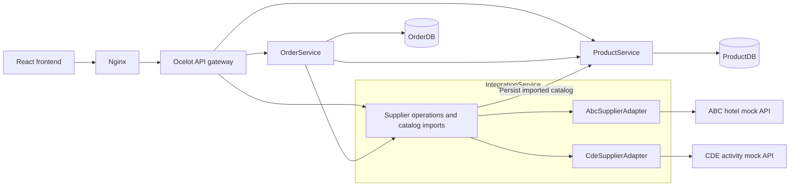

# Core Booking Platform

## Project overview

Core Booking Platform is a booking application that combines hotels and activities from different suppliers in one cart and checkout. Customers browse imported products, select dates and options, get live supplier quotes, confirm bookings, and cancel orders. A management area supports catalog imports, product content, categories, activation, and order inspection.

The project demonstrates a React frontend, an Ocelot API gateway, ASP.NET Core microservices, Entity Framework Core, SQL Server, and supplier integration through adapters. ABC Hotels and CDE Activities are simulated external suppliers with different API contracts.

This is a local assignment/demo application. Authentication, payments, and durable supplier booking storage are not implemented.

## Architecture

The main request flow is **React → Ocelot → microservices → supplier adapters → supplier APIs**. In Docker, Nginx serves the React build and forwards `/api/` requests to Ocelot.



ProductService owns the imported catalog. OrderService owns carts, orders, and supplier booking records. IntegrationService translates between the platform's common contracts and each supplier's contract. Services communicate over HTTP; they do not query each other's databases.

### Microservices and applications

| Component | Responsibility |
| --- | --- |
| `Frontend` | React and TypeScript customer and management screens, using Vite, Tailwind CSS, native shadcn/ui components, React Router, and Axios. |
| `ApiGateway` | Routes frontend API requests to their owning services through Ocelot. Uses `ocelot.json` locally and `ocelot.Docker.json` in Compose. |
| `ProductService` | Suppliers, imported products, categories, active states, descriptions, images, and other product content in ProductDB. |
| `OrderService` | Cart persistence, live quotes, checkout, supplier booking references, compensation, and cancellation in OrderDB. |
| `IntegrationService` | Supplier selection, normalized availability/booking/cancellation operations, and catalog import orchestration. |
| `AbcMockApi` | Hotel catalog, room availability, nightly pricing, hotel bookings, and cancellation. |
| `CdeMockApi` | Activity catalog, packages, time slots, participant pricing, seat availability, bookings, and cancellation. |

### Repository layout

```text
CoreBookingPlatform/
├── ApiGateway/
├── ProductService/          # Controllers, services, repositories, DTOs, models, EF migrations
├── OrderService/            # Controllers, services, repositories, HTTP clients, EF migrations
├── IntegrationService/      # Controllers, orchestration, adapters, normalized/supplier models
├── AbcMockApi/              # Hotel endpoints and Data/hotels.json
├── CdeMockApi/              # Activity endpoints and Data/activities.json
├── Frontend/                # Customer pages, management pages, components, API services
├── scripts/                 # Mock supplier verification
├── docker-compose.yml
└── CoreBookingPlatform.slnx
```

## Adapter pattern

Both `AbcSupplierAdapter` and `CdeSupplierAdapter` implement [`ISupplierAdapter`](IntegrationService/Adapters/Interfaces/ISupplierAdapter.cs):

- `SupplierCode` and `SupplierName`: identify the supplier and provide its display name.
- `GetProductsAsync`: returns a normalized catalog.
- `CheckAvailabilityAsync`: returns normalized availability and pricing.
- `CreateBookingAsync`: creates a supplier booking and returns its reference and status.
- `CancelBookingAsync`: cancels a supplier booking.

`SupplierAdapterRegistry` resolves DI-registered adapters by code, rejects duplicate codes at startup, and provides supplier discovery metadata. `SupplierIntegrationService` uses that registry for catalog, availability, booking, and cancellation operations. OrderService works with common request/response DTOs rather than supplier-specific field names.

| Platform concept | ABC Hotels | CDE Activities |
| --- | --- | --- |
| Product reference | Hotel code | Activity ID |
| Option reference | Room code | Package ID |
| Selection | Check-in/out, rooms, adults, children | Activity date, time slot, adults, children |
| Price | Room rate × rooms × nights | Adult and child rates × participant counts |

The adapters map these differences into models under `IntegrationService/Models/Common`. Each normalized product carries `ProductType`, currently `Hotel` or `Activity`. OrderService validation and React booking controls use that type; supplier codes select adapters and maintain supplier references. A supplier can return products of both supported types.

### Adding a supplier

For a supplier offering an existing product type:

1. Implement `ISupplierAdapter` and return the common Hotel/Activity contract.
2. Register its HTTP client and adapter in IntegrationService and configure its API URL.
3. Rebuild IntegrationService and run catalog sync using the discovered supplier.

The sync dialog discovers suppliers using `GET /api/integration/suppliers`, including suppliers not imported yet. Sync registers the supplier in ProductDB by code before importing products. Registration is idempotent, including concurrent requests, and never renames or reactivates an existing supplier. No supplier-specific edits to OrderService, ProductService, gateway routes, or React are needed, and onboarding needs no migration or seed edit.

Existing databases need the one-time `AddProductType` migration before running this version. It backfills ABC products as Hotel and CDE products as Activity while preserving existing data. See [supplier onboarding and upgrade instructions](docs/SUPPLIER_ONBOARDING.md) for the adapter example, migration commands, Docker rebuild commands, and verification checks.

Catalog import and availability are separate operations. Import stores descriptions and selectable options in ProductDB. Availability and prices are requested live from suppliers when a cart is quoted and again before checkout. Adding an item to a cart does not reserve inventory; a successful supplier booking does.

### Supplier statuses and errors

`SupplierContracts` contains the small HTTP contract shared by IntegrationService and OrderService. Booking/cancellation statuses are string enums: `Unknown`, `Pending`, `Confirmed`, `Cancelled`, and `Failed`. ABC and CDE explicitly map their documented `Confirmed`/`Cancelled` values inside their adapters; unrecognized or missing statuses become `Unknown`. A confirmation without a supplier reference is not accepted. Order/customer API status strings and database schemas are unchanged.

Supplier failures use a JSON envelope with `code`, `outcome`, and a safe `message`, for example:

```json
{
  "code": "Conflict",
  "outcome": "Rejected",
  "message": "The supplier rejected the operation because of a conflict."
}
```

Each adapter owns the interpretation of its supplier's errors. ABC/CDE's 400, 404, and 409 responses explicitly reject the operation under their mock contracts. Authentication failures, rate limiting, timeouts, connection failures, server failures, and malformed responses retain an `Unknown` outcome. IntegrationService returns 400/404/409 for the corresponding rejections, 503 for rate limiting, 504 for timeouts, and 502 for other supplier failures. Raw supplier response bodies are never forwarded.

OrderService relies on the explicit normalized rejection, not the HTTP status alone. Bare/legacy error bodies remain uncertain even with HTTP 409. Checkout compensates earlier confirmed bookings after either rejection or uncertainty; uncertainty or unconfirmed compensation produces `RequiresAttention`. Cancellation requires the normalized `Cancelled` status and matching supplier reference. No automatic booking retries or reconciliation worker are added.

After upgrading, rebuild IntegrationService and OrderService together. No database migration is needed. Run `dotnet run --project tests/SupplierNormalizationChecks` for isolated adapter, HTTP contract, and checkout failure checks without SQL Server or live suppliers.

ProductService, OrderService, and IntegrationService use ASP.NET Core's built-in exception handler and Problem Details for unexpected failures. Recognized validation/supplier errors keep their existing responses; unexpected errors are logged and return a generic HTTP 500 response. Cart additions report ProductService connection failures as 502 and timeouts as 504. Caller cancellation propagates, while a downstream cancellation timeout persists `CancellationFailed` so the cancellation can be retried. Category deletion maps SQL foreign-key conflicts to 409; unrelated database failures reach the centralized handler.

## Database design

Compose runs one SQL Server instance containing two service-owned databases. EF Core migrations define each schema. The SQL Server data directory is persisted in the `sqlserver_data` named volume.

### ProductDB

| Entity | Purpose and relationships |
| --- | --- |
| `Suppliers` | Supplier code, name, and active state. Supplier code is unique. Existing ABC/CDE seeds remain for compatibility; catalog sync registers new suppliers automatically. |
| `Categories` | Internal product classification. Deletion is restricted while products reference the category. |
| `Products` | Supplier reference, product type, name, location, category, active state, update timestamp, and attributes JSON. The pair `(SupplierId, SupplierProductId)` is unique. |
| `ProductContents` | One-to-one product content: description, image metadata, highlights, facilities, inclusions, exclusions, and additional JSON. Deleted with its product. |

The supplier seed creates supplier identities, not hotel or activity products. Run catalog imports to populate products. Reimport updates supplier-managed fields and overwrites local product content, while preserving existing category assignments and active states.

### OrderDB

| Entity | Purpose and relationships |
| --- | --- |
| `Carts` | Cart ID and creation timestamp. |
| `CartItems` | Product ID, selected supplier option, dates/time slot, rooms, and guest counts. Each item belongs to a cart. |
| `Orders` | Cart reference, customer name, status, currency, total, errors, and creation timestamp. A unique CartId permits only one order per cart. |
| `Bookings` | One record per order/cart-item pair, containing the selection snapshot, supplier references, idempotency key, status, currency, total, and errors. Each belongs to an order. |

Booking idempotency keys and `(OrderId, CartItemId)` pairs are unique. Product IDs in OrderDB are references to ProductService data, without cross-database foreign keys.

Mock supplier catalogs and starting inventory are configured in [`hotels.json`](AbcMockApi/Data/hotels.json) and [`activities.json`](CdeMockApi/Data/activities.json). Their runtime reservations, booking records, and idempotency keys are held in memory, outside these databases.

## API endpoints

The following routes are available through Ocelot at `http://localhost:8084` in Docker. The frontend's Nginx proxy also exposes them under `http://localhost:3000/api/...`.

### Products and suppliers

| Method | Route | Purpose |
| --- | --- | --- |
| GET | `/api/product` | List imported products, including inactive products. The customer UI filters inactive entries. |
| GET | `/api/product/{id}` | Get a product and its options/attributes. |
| GET | `/api/product/supplier/{supplierId}` | List products for a supplier. |
| GET | `/api/product/supplier/{supplierId}/product/{supplierProductId}` | Find a product by supplier reference. |
| GET | `/api/products/{productId}/content` | Get product content. |
| GET | `/api/supplier` | List suppliers. |
| GET | `/api/supplier/{id}` | Get a supplier. |
| GET | `/api/supplier/code/{code}` | Find a supplier by code. |

Catalog routes use singular `/api/product`; content routes use plural `/api/products`.

### Gateway Swagger UI

Open [gateway Swagger in Docker](http://localhost:8084/swagger), or `https://localhost:7000/swagger` when running the gateway's local HTTPS profile. The gateway hosts one Swagger UI with **Product Service**, **Order Service**, and **Integration Service** available in the definition dropdown.

The gateway uses [MMLib.SwaggerForOcelot](https://github.com/Burgyn/MMLib.SwaggerForOcelot) 11.0.0 to fetch each service's `/openapi/v1.json`, filter it using the Ocelot routes and their `SwaggerKey`, and rewrite the server URL so **Try it out** sends requests through the gateway. Internal service-only routes and the mock supplier APIs remain documented at their own Swagger pages.

Swagger is enabled in Development, as are the downstream OpenAPI documents. All three core services must be running for their documents to load. Local configuration uses the service HTTPS URLs; Docker configuration uses Compose service names on port 8080. The existing `OcelotConfigFile` setting selects both the routes and matching Swagger endpoints.

After changing gateway code or its package dependencies, rebuild the Docker gateway with `docker compose up -d --build api-gateway`. No database migration is required for documentation changes.

### Cart, quote, checkout, and cancellation

| Method | Route | Purpose |
| --- | --- | --- |
| POST | `/api/carts` | Create a cart. |
| GET | `/api/carts/{cartId}` | Get its items. |
| POST | `/api/carts/{cartId}/items` | Add a hotel or activity selection. |
| PUT | `/api/carts/{cartId}/items/{itemId}` | Replace an item's booking selection and return the updated cart. The product and item ID stay unchanged. |
| DELETE | `/api/carts/{cartId}/items/{itemId}` | Remove a selection. |
| GET | `/api/carts/{cartId}/quote` | Get fresh supplier availability and prices. |
| POST | `/api/carts/{cartId}/checkout` | Revalidate and book the cart; body: `{ "customerName": "Demo customer" }`. |
| GET | `/api/orders/{orderId}` | Get the order and saved supplier booking details, including dates, guests, options, currencies and confirmation references. |
| PUT | `/api/orders/{orderId}` | Update the locally stored order customer name; body: `{ "customerName": "Updated customer" }`. |
| POST | `/api/orders/{orderId}/cancel` | Cancel a confirmed order or retry a failed cancellation. |
| POST | `/api/integration/availability` | Request live supplier pricing and availability; used by the hotel room input. |

Adding an item requires the internal `productId` and a `supplierOptionId` from that product's attributes. Include `adults`, `children`, and `rooms`. Hotels require `checkIn` and `checkOut`; activities require `activityDate` and a supported `timeSlot`. Dates use `yyyy-MM-dd`. Do not send both hotel and activity date fields in the same selection.

Updating an item uses the same complete request body as adding one, including the original `productId`. Dates, occupancy, option capacity, passenger types, and activity time slots are validated before saving. Missing carts/items return 404, invalid selections return 400, and editing a cart that already has an order returns 409. Editing does not reserve inventory; the React cart refreshes its live quote after a successful save.

Checkout returns HTTP 200 for a confirmed order, 409 for a failed order, and 202 for an order that is not confirmed and needs further attention. A 202 response must not be treated as a successful booking. Failed cancellation returns 202 and can be retried through the same cancellation endpoint.

Order customer updates trim whitespace and require 1–200 characters. The update returns the saved order, 400 for an invalid name, or 404 for an unknown order. It changes only the core order record; supplier reservation names, selections, prices and statuses remain as originally booked. Management order details provide this edit form. Booking status changes follow the checkout and cancellation workflows. No migration is required for the expanded responses or customer-name update.

### Management

| Method | Route | Purpose |
| --- | --- | --- |
| PUT | `/api/product/{id}` | Update `categoryId` and `isActive`. |
| PUT / DELETE | `/api/products/{productId}/content` | Save or delete product content. |
| GET / POST | `/api/category` | List or create categories. |
| GET / PUT / DELETE | `/api/category/{id}` | Read, update, or delete a category. Assigned categories cannot be deleted. |
| GET | `/api/orders?page=1&pageSize=20` | List orders, newest first; page size is limited to 100. |
| GET | `/api/integration/suppliers` | Discover registered adapter codes and names, including suppliers not imported yet. |
| POST | `/api/integration/import/{supplierCode}` | Import a registered supplier; returns total, created, updated, failed, and error details. |

### Service-to-service routes

These endpoints are called directly between services and are not exposed by the current gateway routes:

| Service | Method and route | Purpose |
| --- | --- | --- |
| ProductService | `POST /api/internal/suppliers/register` | Idempotently register a supplier before catalog import. Existing names and active states are preserved. |
| ProductService | `POST /api/internal/products/import` | Persist one normalized supplier product and its supported product type. |
| IntegrationService | `GET /api/integration/products` | Read all supplier catalogs without importing. |
| IntegrationService | `GET /api/integration/products/{supplierCode}` | Read one supplier's normalized catalog. |
| IntegrationService | `POST /api/integration/bookings` | Create a supplier booking. |
| IntegrationService | `POST /api/integration/bookings/cancel` | Cancel a supplier booking. |

The Integration import endpoint and ProductService's internal registration/import endpoints return 404 outside Development. The current Compose configuration sets Development for the services. The name `internal` is a routing convention, not an authorization mechanism.

## Docker setup

### Requirements

- Docker Desktop with Linux containers and Docker Compose v2.
- The .NET 10 SDK and the EF Core 10 CLI on the host for the initial database migration commands below.
- PowerShell 7 for the setup examples.
- Host Node.js is only needed for frontend development outside Docker; the frontend image builds with Node 22 and runs with Nginx.

Run the following commands from the repository root. The services do **not** automatically apply migrations on startup.

### 1. Configure the local environment

Create a root `.env` file containing a strong SQL Server password:

```dotenv
MSSQL_SA_PASSWORD=replace-with-your-own-strong-password
```

Replace the placeholder with a password meeting SQL Server's complexity requirements. `.env` is ignored by Git and excluded from Docker build contexts. Compose reads it to supply the SQL Server password and service connection strings. Do not put credentials in frontend `VITE_*` variables: those values are compiled into browser code.

Compose already supplies the remaining settings:

| Setting | Used by | Docker value |
| --- | --- | --- |
| `ASPNETCORE_ENVIRONMENT` | Backend services | `Development` |
| `ASPNETCORE_HTTP_PORTS` | Backend services | `8080` |
| `ConnectionStrings__DefaultConnection` | ProductService / OrderService | SQL Server host `sqlserver,1433`, database `ProductDB` / `OrderDB`. |
| `SupplierApis__ABC` | IntegrationService | `http://abc-mock:8080/` |
| `SupplierApis__CDE` | IntegrationService | `http://cde-mock:8080/` |
| `ProductService__BaseUrl` | IntegrationService | `http://product-service:8080/` |
| `Services__ProductService` | OrderService | `http://product-service:8080/` |
| `Services__IntegrationService` | OrderService | `http://integration-service:8080/` |
| `OcelotConfigFile` | ApiGateway | `ocelot.Docker.json` |
| `VITE_API_BASE_URL` | Frontend build argument | Empty string, so API requests use the frontend's origin. |

Double underscores in backend environment variable names represent configuration nesting, such as `Services:ProductService`. Container-to-container requests use Compose service names and port 8080, rather than host-published ports or `localhost`.

### 2. Start SQL Server and apply migrations

```powershell
docker compose config --quiet
docker compose up -d sqlserver
docker compose logs -f sqlserver
```

Wait until SQL Server reports that it is ready for client connections, then press Ctrl+C to stop following logs. This leaves the container running. Compose currently uses startup dependencies without readiness health checks.

Install the matching EF CLI if it is not already installed:

```powershell
dotnet tool install --global dotnet-ef --version 10.0.14
```

If `dotnet-ef` is already installed, check `dotnet ef --version` and use a compatible 10.x version. The CLI runs on the host, so its connection uses published SQL port **14333**. Compose's `.env` is not automatically loaded by the EF CLI; enter the same password when prompted:

```powershell
$databasePassword = Read-Host -MaskInput "Enter the SQL password from .env"

$env:ConnectionStrings__DefaultConnection = "Server=localhost,14333;Database=ProductDB;User Id=sa;Password=$databasePassword;Encrypt=True;TrustServerCertificate=True;"
dotnet ef database update --project ProductService/ProductService.csproj --startup-project ProductService/ProductService.csproj

$env:ConnectionStrings__DefaultConnection = "Server=localhost,14333;Database=OrderDB;User Id=sa;Password=$databasePassword;Encrypt=True;TrustServerCertificate=True;"
dotnet ef database update --project OrderService/OrderService.csproj --startup-project OrderService/OrderService.csproj

Remove-Item Env:\ConnectionStrings__DefaultConnection
Remove-Variable databasePassword
```

Confirm both migration commands succeed before continuing. They create/update the databases and apply the ABC/CDE supplier seed. Reuse existing migrations; no new migration is needed for setup.

### 3. Build and start the application

```powershell
docker compose up -d --build
docker compose ps
```

Open [the frontend](http://localhost:3000) and [Management](http://localhost:3000/management). Import both suppliers using **Sync supplier catalog**. Alternatively, call the gateway:

```powershell
Invoke-RestMethod -Method Post -Uri "http://localhost:8084/api/integration/import/ABC"
Invoke-RestMethod -Method Post -Uri "http://localhost:8084/api/integration/import/CDE"
```

Imports return a summary even when individual items fail. Check `failed` and `errors`; HTTP 200 alone does not prove that every product was imported.

### Addresses

All published ports bind to `127.0.0.1` in the supplied Compose file.

| Component | Host address | Container port |
| --- | --- | --- |
| Frontend | [http://localhost:3000](http://localhost:3000) | 80 |
| API gateway Swagger | [http://localhost:8084/swagger](http://localhost:8084/swagger) | 8080 |
| ProductService Swagger | [http://localhost:8081/swagger](http://localhost:8081/swagger) | 8080 |
| IntegrationService Swagger | [http://localhost:8082/swagger](http://localhost:8082/swagger) | 8080 |
| OrderService Swagger | [http://localhost:8083/swagger](http://localhost:8083/swagger) | 8080 |
| ABC mock Swagger | [http://localhost:5101/swagger](http://localhost:5101/swagger) | 8080 |
| CDE mock Swagger | [http://localhost:5102/swagger](http://localhost:5102/swagger) | 8080 |
| SQL Server | `localhost,14333` | 1433 |

Host ports 5101/5102 above are the Docker mappings. Local .NET launch profiles use ABC on 5102 and CDE on 5101 instead. The Docker IntegrationService settings correctly use service names, so these host mappings do not affect supplier calls.

Nginx forwards `/api/` to `api-gateway:8080` and serves `index.html` for React routes such as `/management`. This keeps browser API requests on the same origin. Frontend API configuration is fixed at image build time; rebuild the frontend image after changing its build argument.

### Logs, rebuilds, and shutdown

```powershell
docker compose logs -f frontend api-gateway integration-service
docker compose up -d --build frontend
docker compose up -d --build abc-mock cde-mock integration-service
docker compose down
```

`docker compose down` preserves the named SQL data volume. Adding `--volumes` deletes that persisted database storage. Restarting either mock clears its in-memory bookings even when SQL data remains intact.

After editing supplier JSON, rebuild/recreate the affected mock image, then run its catalog import to update persisted product content. A container restart alone does not copy source changes into an existing image.

## Example workflow: a hotel and activity in one booking

1. Start the stack, apply migrations, and import both supplier catalogs.
2. Open **Products** and select **Ocean View Hotel** (`ABC-H001`). Choose a Standard Room (`STD`), one room, two adults, and future check-in/out dates. Add it to the cart.
3. Select **Colombo City Walking Tour** (`CDE-A101`). Choose Morning Group Tour (`MORNING`), a future activity date, a supported time slot such as `09:00`, and two adults. Add it to the same cart.
4. Open **Cart**. The quote requests current availability and prices for both selections through IntegrationService and the supplier adapters. Use **Edit** to change an option, dates, time slot, or guest/room counts. The Rooms input checks live inventory when room type or stay dates change and limits the selection to the available count. Additions and edits check supplier availability before saving. Saving keeps the same cart item and refreshes its live quote; **Cancel** leaves the original selection unchanged.
5. Continue to **Checkout**, enter a customer name, and confirm. OrderService obtains a fresh quote, creates one order, and requests one supplier booking for each cart item.
6. Verify the order is **Confirmed** and both supplier booking references are present. Save the order reference; **My bookings** stores recent references in the current browser.
7. Open the order and choose **Cancel**. The platform cancels the supplier bookings and updates their stored statuses. If cancellation fails, inspect the returned state and use the supported retry action.

Checkout uses persisted booking records and idempotency keys to support retries. If a later supplier booking fails after another has confirmed, OrderService attempts to cancel the confirmed booking as compensation. Unknown supplier outcomes or incomplete compensation produce `RequiresAttention`; there is no distributed database transaction across the suppliers.

## Development and verification

For local development without Docker, configure ProductService and OrderService connection strings using user secrets or environment variables, apply their migrations, and run all backend projects using their HTTPS launch profiles. Trust the local ASP.NET development certificate. IntegrationService and OrderService settings include the local HTTP service addresses.

The local frontend defaults to `https://localhost:7000`. From `Frontend`, copy `.env.example` to `.env.local`, install dependencies with `npm ci`, and run `npm run dev` at `http://localhost:5173`. The gateway allows the local Vite origins on port 5173. See the [frontend README](Frontend/README.md) for UI details and manual acceptance checks.

Build and lint commands, run from the repository root:

```powershell
dotnet build CoreBookingPlatform.slnx
npm --prefix Frontend run build
npm --prefix Frontend run lint
dotnet run --project tests/CartItemUpdateChecks
```

[`scripts/Test-MockSuppliers.ps1`](scripts/Test-MockSuppliers.ps1) verifies mock catalog contracts, rates, inventory, idempotency, and cancellation. Run it against fresh isolated mock instances on its default ports 15102/15101, or supply `-AbcBaseUrl` and `-CdeBaseUrl`. It expects starting inventory and should not target an active booking demo.

The cart-update checks use in-memory carts and deterministic product/supplier responses, without accessing SQL Server or creating live supplier bookings. They cover successful edits, item identity, invalid-selection rollback, capacity/time-slot validation, and checked-out cart protection. An optional `-- --serve` argument starts the same isolated cart fixture on port 15173 for browser verification.

## Known limitations

- No authentication, customer accounts, roles, or order ownership checks. Management and order APIs are accessible to anyone who can reach the application. The current setup is intended for a local demonstration.
- No payment gateway, payment collection, or refunds. Booking confirmation does not represent payment.
- Mock bookings, reservations, and idempotency keys are not durable. A mock restart resets inventory while core orders remain in SQL Server, potentially leaving inconsistent demo state.
- Catalog imports are Development-only. Moving imports to another environment requires a deliberate configuration/access-control design rather than simply removing the guard.
- Cart additions do not hold inventory; prices and availability can change before supplier confirmation. Checkout blocks unavailable selections and mixed-currency quotes.
- Uncertain supplier outcomes and incomplete compensation require operator reconciliation. No background reconciliation worker is implemented.
- Cancellation is supported for confirmed orders and retries of failed cancellation, rather than arbitrary status editing.
- Cart editing changes the selection for the existing product. To switch to a different product, remove the item and add the other product.
- Reimport overwrites locally edited product content. Categories and active states are preserved.
- Recent booking references depend on browser storage. Clearing it removes that browser's history; manually retained order IDs can still be looked up.
- Localhost URL defaults, published internal-service ports, Development mode, and SQL Server administrator credentials in the demo Compose configuration require review before deployment.
